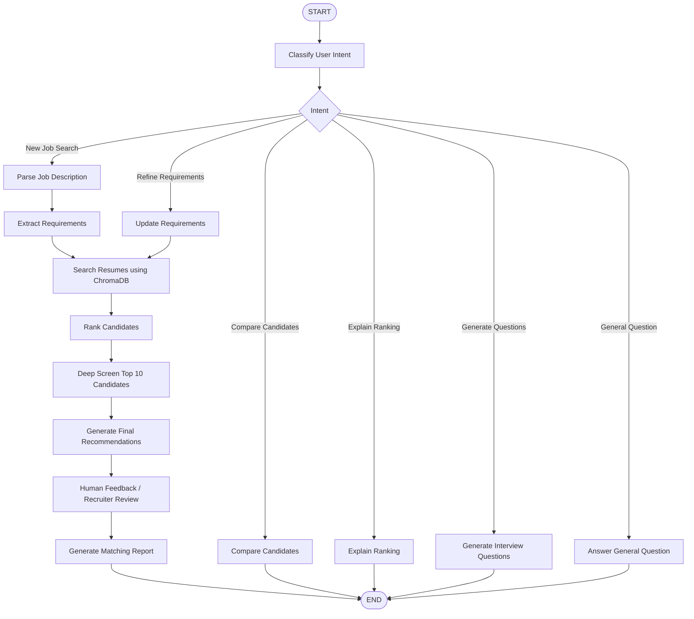

# Resume Matching Agent - State Machine

## Workflow Description

1. **Classify User Intent:** Identifies whether the recruiter wants a new search, requirement refinement, comparison, explanation, or interview questions.
2. **Parse Job Description:** Captures the job description supplied by the recruiter.
3. **Extract Requirements:** Identifies required skills, must-have skills, and minimum experience.
4. **Search Resumes:** Retrieves relevant resume chunks from ChromaDB.
5. **Rank Candidates:** Scores candidates using semantic similarity and skill coverage.
6. **Deep Screening:** Performs a second-round analysis of shortlisted candidates.
7. **Final Recommendations:** Generates interview, further-review, or do-not-recommend suggestions.
8. **Human Feedback:** Pauses the workflow for recruiter review and captures feedback.
9. **Generate Report:** Produces the final candidate matching report.
10. **Conversation Routes:** Supports candidate comparisons, ranking explanations, interview questions, and general recruitment questions.
